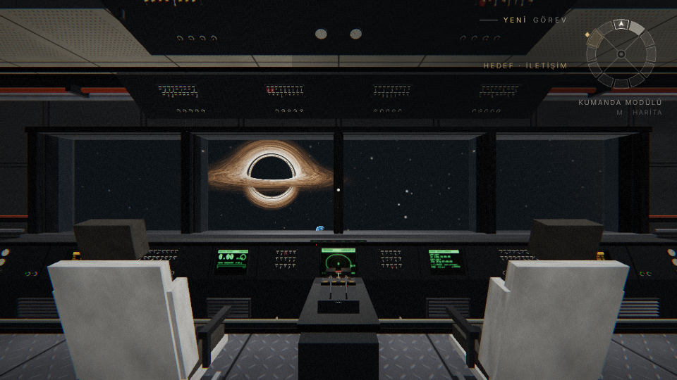

# AZİM — Interstellar esintili uzay gemisi

Interstellar filmindeki **Endurance**'tan esinlenen, içinde birinci şahıs (FPS) olarak dolaşıp
etkileşime girdiğin 3B bir uzay gemisi. Tarayıcıda çalışır (Three.js + Vite), kurulum gerektiren
hiçbir dosya ya da sunucu yoktur. Tüm sesler ve dokular kodla üretilir.



## Oynamak

```bash
cd uzay-gemisi
npm install
npm run dev          # http://localhost:5173
```

Tek dosyalık sürüm: `npm run build:single` → `dist-single/index.html` (çift tıklayıp açılabilir).

### Kontroller

| Tuş | İşlev | Tuş | İşlev |
|---|---|---|---|
| W A S D | Hareket | Fare | Etrafa bak |
| Shift | Koş | C / Ctrl | Eğil |
| Space | Zıpla | E | Etkileşim |
| F | El feneri | M / Tab | Halka haritası |
| 1–9, W/S + E | Terminalde seç | Esc | Duraklat / ayarlar |

Telefonda dokunmatik kontroller açılır: sol tarafta hareket kolu, sağ tarafta sürükleyerek bakış,
ekranda etkileşim, zıplama, eğilme, koşma, harita ve fener düğmeleri.
Ayarlar menüsünde fare hassasiyeti, görüş alanı, ses düzeyleri ve grafik kalitesi değiştirilebilir.

## Hikâye

Hiper-uykudan uyanıyorsun. Gemi acil durum enerjisinde, koridorlar kırmızı ve karanlık.
Yanında robot **TARS** var (mizah ve dürüstlük ayarlarıyla).

1. TARS ile konuş.
2. Motor modülüne git, sigorta panelini doğru sırayla sıfırla ve enerjiyi geri getir.
   Sıra, panelin yanındaki teşhis ekranında yazar.
3. İletişim modülünde Dünya'dan gelen mesajları dinle. Zaman genişlemesi yüzünden yıllar geçmiştir.
4. Kumanda modülünde (enerji gelene kadar kilitli) halkanın dönüşünü başlat.
5. Gözlem güvertesindeki teleskopla **Gargantua**'yı incele.

Yaşam alanındaki kitaplıkta gizli bir Mors mesajı var.

## Gemi

Halka, merkezdeki kenetlenme göbeğinin çevresinde 12 modülden oluşur. Göbekte Ranger ve Lander kenetlidir.

| # | Modül | Öne çıkanlar |
|---|---|---|
| 0 | Kumanda | Panoramik pencere, pilot koltukları, dönüş sekansı |
| 1 | Hiper-Uyku | Kapsüller, yaşamsal ekranlar (başlangıç) |
| 2 | Yaşam Alanı | Mutfak, kahve makinesi, Mors kodlu kitaplık |
| 3 | Revir | Tarayıcılı tıbbi yatak |
| 4 | Laboratuvar | Mikroskop, santrifüj, kütleçekim denklemleri |
| 5 | Hidroponik | Mor büyüme ışıkları altında mısır |
| 6 | Motor ve Enerji | Reaktör, sigorta bulmacası |
| 7 | Robotik | Robot kol, şarjdaki yedek robot PİRİ |
| 8 | Kargo | Açılabilir kasalar |
| 9 | Hava Kilidi | EVA giysileri, hava kilidi döngüsü, Ranger manzarası |
| 10 | İletişim | Dünya'dan mesajlar, anten hizalama |
| 11 | Gözlem | Teleskop, kara delik manzarası |

Uzayda ışın yürütmeli kara delik (merceklenmiş yığılma diski), Satürn, küresel solucan deliği ve
Miller gezegeni var. Halka dönmeye başlayınca manzara pencerelerden kayar, güneş ışığı yere düşer.

## Nasıl yapıldı: 7 ajanlı ekip

Proje, bir koordinatör ve paralel çalışan 7 Claude ajanıyla geliştirildi. Koordinatör önce iskeleti
(motor, oyuncu, çarpışma, etkileşim, ışık havuzu, halka yerleşimi) ve [ekip sözleşmesini](docs/ARCHITECTURE.md)
yazdı. Her ajan yalnızca kendi dosyalarında çalıştı. Modeller işin zorluğuna göre seçildi.

| Ajan | Alan | Model |
|---|---|---|
| 1 | Malzemeler, prosedürel dokular, modül kabuğu, kapılar, koridorlar, göbek, Ranger/Lander | Opus → Sonnet |
| 2 | Uzay, Gargantua shader'ı, gezegenler, güneş ışığı ve gölgeler | Opus → Sonnet |
| 3 | Kumanda, hiper-uyku, yaşam alanı, revir, iletişim, gözlem modülleri | Opus → Sonnet |
| 4 | Motor, laboratuvar, hidroponik, robotik, kargo, hava kilidi modülleri | Opus |
| 5 | TARS modeli ve diyalogları, görev zinciri, giriş sinematiği | Opus → Haiku |
| 6 | Arayüz, terminal, mini harita, menüler, dokunmatik kontroller, prosedürel ses ve müzik | Opus → Sonnet |
| 7 | Birim ve uçtan uca testler, kalite raporu | Opus → Haiku |

## Geliştirme

```bash
npm test                 # birim testleri (vitest)
npm run test:e2e         # uçtan uca testler (Playwright)
npm run build            # dist/
npm run build:artifact   # dist-artifact/azim.html (claude.ai Artifact sayfası)
node scripts/walk-check.mjs "<url>?autostart=1&nointro=1&flags=power_restored&quality=low"
node scripts/shot.mjs --url "<url>?autostart=1&nointro=1&tp=engine" --out shots/x.png
```

Hata ayıklama için URL parametreleri (`tp`, `pos`, `cam`, `flags`, `quality`, `debug`) ve
`window.__game` API'si [docs/ARCHITECTURE.md](docs/ARCHITECTURE.md) içinde anlatılıyor.

```
src/
  core/         motor, olay yolu, oyun durumu, giriş
  player/       FPS kontrolcüsü, 2B çarpışma, el feneri
  interaction/  bakılan nesneyle etkileşim
  world/        halka yerleşimi, gemi kurulumu, ışık havuzu, malzemeler
    structure/  kabuk, kapı, koridor, dokular
    exterior/   göbek, Ranger, Lander
    modules/    12 modül (+ crew/, tech/ yardımcıları)
  space/        yıldızlar, Gargantua, gezegenler
  gameplay/     TARS, görevler
  ui/           arayüz, terminal, harita, dokunmatik kontroller
  audio/        prosedürel ses ve müzik
```

Bu, hayran yapımı ve ticari olmayan bir projedir. Interstellar ve içindeki adlar hak sahiplerine aittir.
Diyaloglar ve metinler özgündür.
